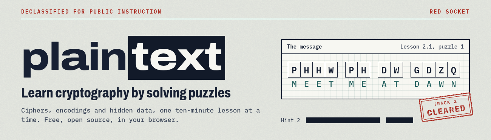

# Plaintext



A game-first platform for learning cryptography and informatics: encodings, classic ciphers, hidden data and how computers store things, taught through puzzles in the style of ARGs and puzzle hunts.

Play it at **[red-socket.github.io/plaintext](https://red-socket.github.io/plaintext/)**.

Want to write a puzzle? Start with [CONTRIBUTING.md](CONTRIBUTING.md) and [docs/AUTHORING.md](docs/AUTHORING.md).

Made by [Red Socket](https://github.com/red-socket).

## Development

```bash
npm install
npm run dev      # http://localhost:4321
npm run build    # static output in dist/
npm run check    # types + tests
npm run verify   # types, tests and build (what CI runs)
```

Built with [Astro](https://astro.build). Pushing to `main` deploys to GitHub Pages (`.github/workflows/pages.yml`). Pages serves the site under `/plaintext`, so that build sets `BASE_PATH=/plaintext`; other hosts build from the root as usual.

## Licence

Copyright © 2026 Red Socket.

- **Code** is licensed under the [GNU Affero General Public License v3.0 or later](LICENSE). If you run a modified copy as a public site, you must publish your changes under the same licence.
- **Lessons and puzzles** (everything in `src/content/`) are licensed under [Creative Commons Attribution-ShareAlike 4.0](src/content/LICENSE). You can share and adapt them, with credit, under the same licence.
- **The word list** (`public/files/words.txt`) comes from [SCOWL](http://wordlist.aspell.net/), copyright Kevin Atkinson and others, under the permissive terms in [`public/files/words-COPYRIGHT.txt`](public/files/words-COPYRIGHT.txt). Rebuild it with `node scripts/make_wordlist.mjs`.
